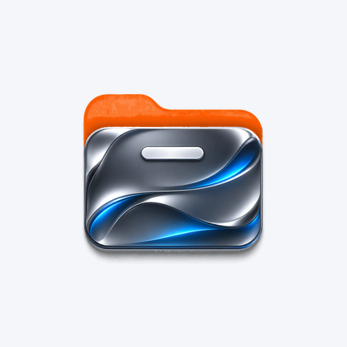
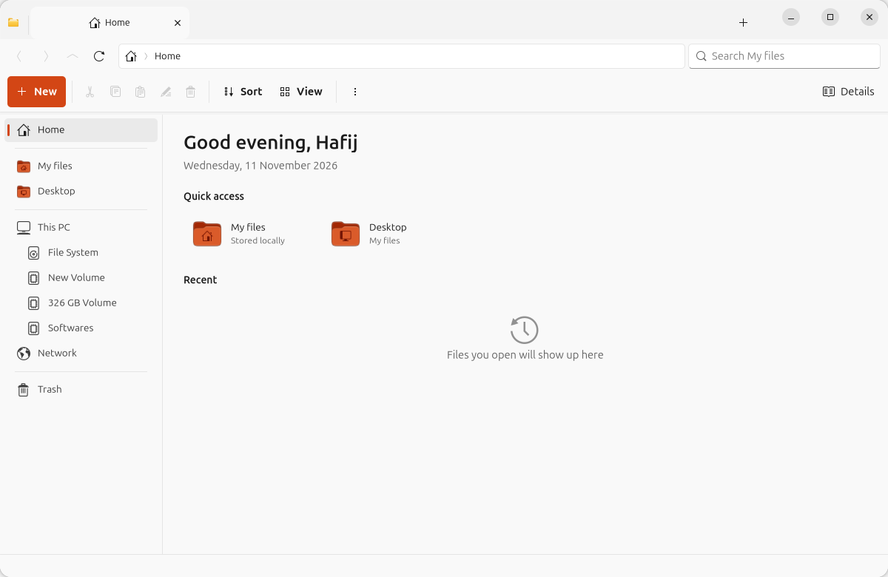
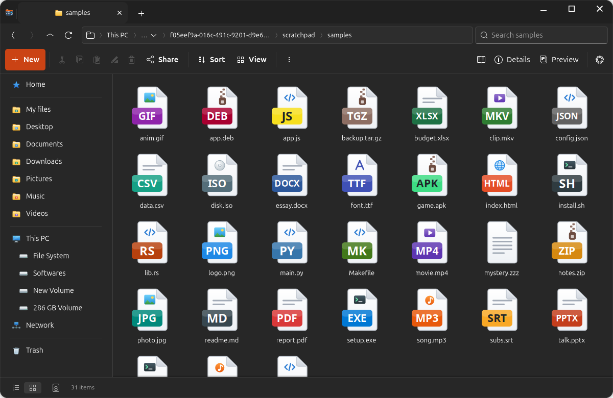
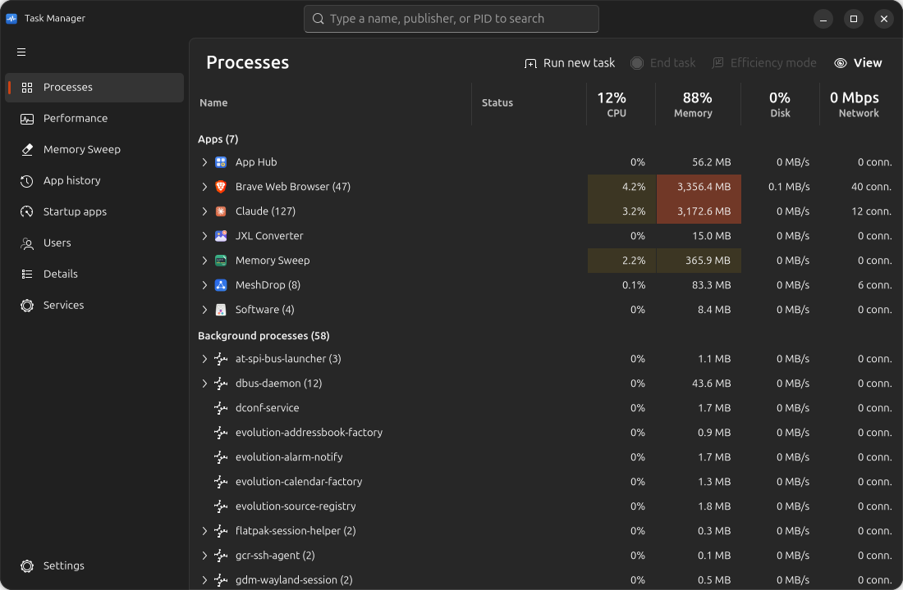
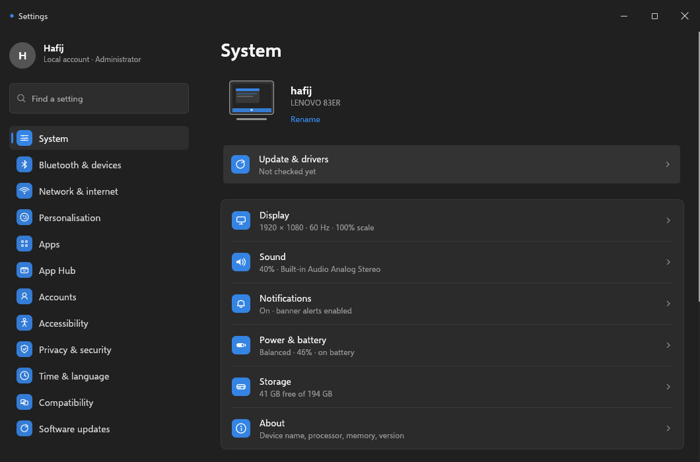
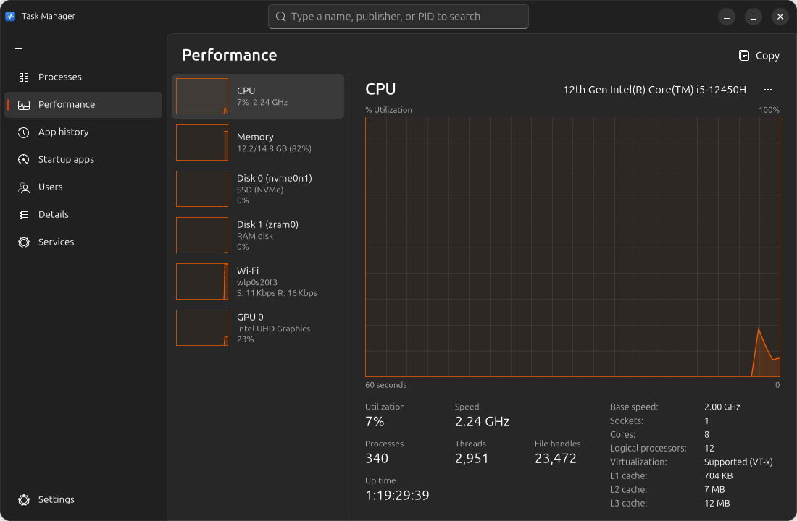
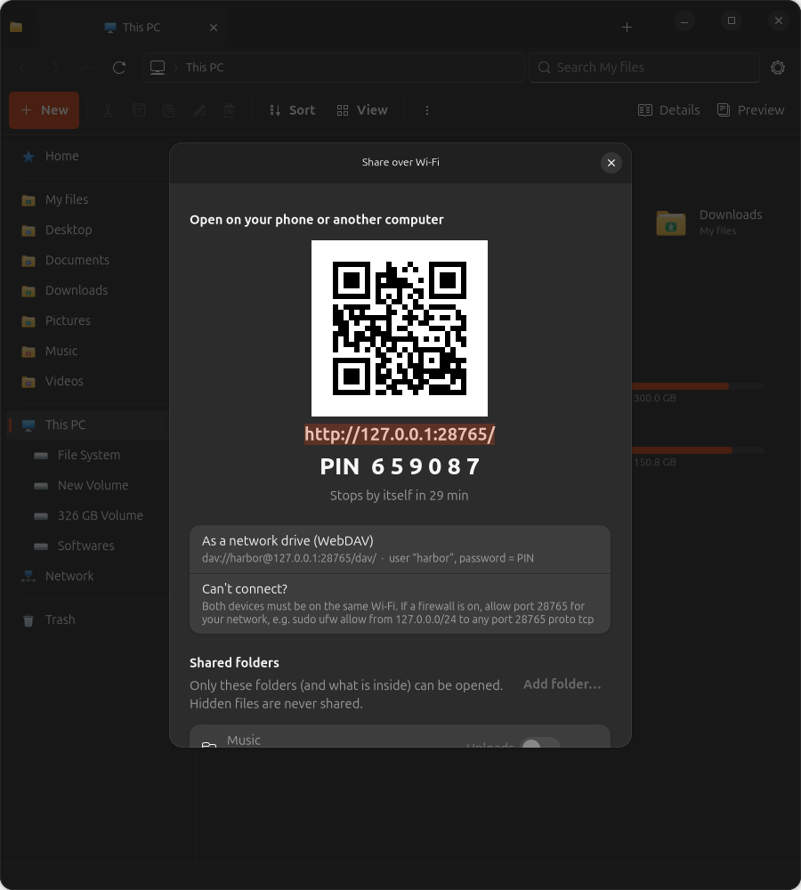

<div align="center">


# Harbor

**Windows 11-style Files, Task Manager and Settings for GNOME, plus a file manager for Android.**

They follow your GNOME light/dark mode and accent colour, and they edit the real system.

[](https://github.com/Hafij-DEU/harbor/releases?q=files-v&expanded=true)
[](https://github.com/Hafij-DEU/harbor/releases?q=taskmgr-v&expanded=true)
[](https://github.com/Hafij-DEU/harbor/releases?q=settings-v&expanded=true)
[](https://github.com/Hafij-DEU/harbor/releases?q=android-v&expanded=true)
<br>
[](LICENSE)


[Apps](#apps) · [Screenshots](#screenshots) · [Install](#install) · [Build](#build-and-test) · [Docs](#documentation)

</div>

---

## Apps

| | App | What it is | Stack | Guide |
| :-: | --- | --- | --- | --- |
|  | **Harbor Files** | File manager with tabs, a ribbon or command bar, previews, folder colours, an icon for every file type, 7-Zip, network places and Share over Wi-Fi. | Python · GTK 4 | [docs/files.md](docs/files.md) |
|  | **Harbor Task Manager** | Processes, live performance graphs, Memory Sweep, startup apps, services and memory tuning (zram, swap, zswap). | Python · GTK 4 | [docs/taskmgr.md](docs/taskmgr.md) |
|  | **Harbor Settings** | Settings app that edits the real system: display, sound, network, Bluetooth, apps, updates, desktop and GNOME extensions. | Rust · egui | [settings/README.md](settings/README.md) |
|  | **Harbor Files for Android** | Phone file manager with a Recent feed, categories, an FTP server and a one-scan link to the PC. | Java · Android 10+ | [android/README.md](android/README.md) |

Each app is a separate package with its own version. Release tags are `files-v…`, `taskmgr-v…`, `settings-v…` and `android-v…`.

## Screenshots

<table>
<tr>
<td width="50%"><a href="docs/files.md"></a><br><sub><b>Files</b>: Home with Quick access and recent files</sub></td>
<td width="50%"><a href="docs/files.md#file-type-icons"></a><br><sub><b>Files</b>: an icon for every file extension</sub></td>
</tr>
<tr>
<td><a href="docs/taskmgr.md"></a><br><sub><b>Task Manager</b>: Processes grouped by Apps, Background and System</sub></td>
<td><a href="settings/README.md"></a><br><sub><b>Settings</b>: System page</sub></td>
</tr>
<tr>
<td><a href="docs/taskmgr.md#performance"></a><br><sub><b>Task Manager</b>: Performance › CPU</sub></td>
<td><a href="docs/files.md#share-over-wi-fi"></a><br><sub><b>Files</b>: Share over Wi-Fi with a QR code and PIN</sub></td>
</tr>
</table>

More pictures are in the [Files guide](docs/files.md#gallery) and the [Task Manager guide](docs/taskmgr.md#gallery).

## Install

Download the packages you want from [Releases](https://github.com/Hafij-DEU/harbor/releases) and install them with apt:

```bash
sudo apt install ./harbor-files_*_all.deb ./harbor-taskmgr_*_all.deb ./win11-settings_*_amd64.deb
```

| Package | Command | Notes |
| --- | --- | --- |
| `harbor-files` | `harbor-files [folder]` | Does not make itself your default file manager. |
| `harbor-taskmgr` | `harbor-taskmgr [--page performance:memory]` | Root-only changes ask through polkit. |
| `win11-settings` | `win11-settings` | Installs under `/usr/local`; Ubuntu's Settings stays. |
| `HarborFiles-<v>.apk` | Android app | Install on the phone; Android 10 or later. |

The packages replace the old combined `harbor` package.

## Build and test

```bash
./build-deb.sh                 # Files and Task Manager; ./build-deb.sh files for one
PYTHONDONTWRITEBYTECODE=1 python3 -m pytest -q -p no:cacheprovider tests/
tools/shot.sh files shot.png   # screenshot in a private headless GNOME Shell
```

- **Settings**: `cd settings && cargo test --release && ./packaging/build-deb.sh`
- **Android**: `cd android && gradle --offline testDebugUnitTest assembleRelease`

`tools/shot.sh` runs the app with `HARBOR_DRY_RUN=1` and private XDG folders, so nothing on the real system changes.

## Documentation

| Guide | Covers |
| --- | --- |
| [docs/files.md](docs/files.md) | Every Harbor Files feature, the file-type icons, sharing and phone links |
| [docs/taskmgr.md](docs/taskmgr.md) | Task Manager pages, Memory Sweep and memory optimisation |
| [settings/README.md](settings/README.md) | Settings pages, App Hub integration, cleaner, environment variables |
| [android/README.md](android/README.md) | Android app features, build and signing |

## Repository layout

```text
src/harbor/      Files and Task Manager (Python, GTK 4, libadwaita)
data/            desktop files, polkit policy, bundled harbor-* icon set
settings/        Harbor Settings (Rust, eframe/egui)
android/         Harbor Files for Android (Gradle)
tools/           icon generators and the headless screenshot harness
tests/           pytest suite
docs/            guides and screenshots
design/          app icon sources
```

## Licence

[MIT](LICENSE) © Md. Hafijur Rahman
