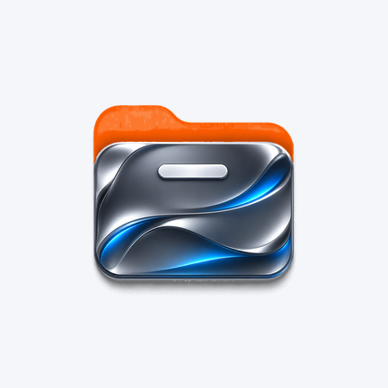

<div align="center">



# Harbor Files for Android

**A phone file manager that talks to Harbor Files on the PC.**

[](https://github.com/Hafij-DEU/harbor/releases?q=android-v&expanded=true)


[← Harbor](../README.md) · [Files](../docs/files.md) · [Task Manager](../docs/taskmgr.md) · [Settings](../settings/README.md)

</div>

---

Package `com.hafij.harborfiles`. Styled after the Xiaomi file manager; tablets get a sidebar layout.

## Features

| Tab | What it does |
| --- | --- |
| **Recent** | Every new file of any kind, grouped by day and by the app or folder it came from. |
| **Browse** | Categories (images, videos, audio, documents, APKs, archives), Downloads, favourites, Recently deleted and storage volumes. |
| **Connect** | Start an FTP server on the phone, open a Harbor PC share, or open any FTP server. |

- **FTP server**: user `harbor` and a 6-digit PIN, a QR code that carries the PIN, optional read-only mode and an idle stop. The notification has **Show QR** and **Stop**.
- **PC link**: scan the QR code of a [Harbor Files share](../docs/files.md#share-over-wi-fi), or type the address and PIN. The PC can also [scan the phone](../docs/files.md#scan-phone-qr).
- **Send** through MeshDrop when it is installed, or through any other app.
- **Settings**: hidden and system folders, screenshots in Recent, Recently deleted keep time, theme, accent colour and server port.

## Build and test

```bash
cd android
gradle --offline testDebugUnitTest assembleRelease
```

| Variable | Purpose |
| --- | --- |
| `HARBOR_KEYSTORE_FILE`, `HARBOR_KEYSTORE_PASSWORD`, `HARBOR_KEY_ALIAS`, `HARBOR_KEY_PASSWORD` | Sign release builds. Without them the debug key is used. |
| `HARBOR_DAV="<port> <pin>"` | Run an extra test against a live desktop share. |

## Install

Download `HarborFiles-<version>.apk` from [Releases](https://github.com/Hafij-DEU/harbor/releases?q=android-v&expanded=true) and open it on the phone.

---

<div align="center"><sub><a href="../README.md">Harbor</a> · <a href="../docs/files.md">Files</a> · <a href="../docs/taskmgr.md">Task Manager</a> · <a href="../settings/README.md">Settings</a></sub></div>
