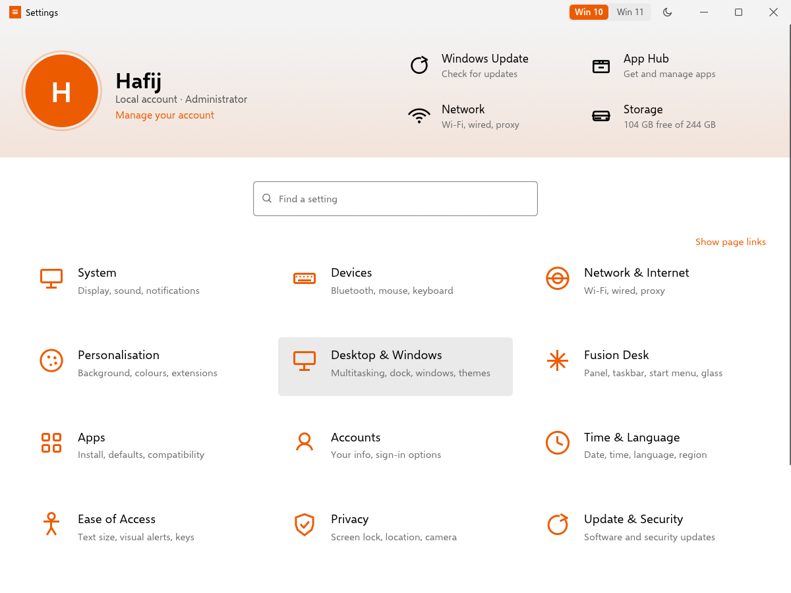

<div align="center">


# Harbor Settings

**A Windows 11-style Settings app for Ubuntu, with a built-in Windows 10 interface — both edit the real system.**

[](https://github.com/Hafij-DEU/harbor/releases?q=settings-v&expanded=true)


[← Harbor](../README.md) · [Files](../docs/files.md) · [Task Manager](../docs/taskmgr.md) · [Android](../android/README.md)

</div>

---


It paints its own Fluent-style chrome (title bar, sidebar, cards, toggles,
sliders) and drives the real Ubuntu stack underneath: `gsettings`/`dconf`,
`wpctl`/`pactl`, `nmcli`, `bluetoothctl`, `powerprofilesctl`,
`org.gnome.Mutter.DisplayConfig`, `AccountsService`, `df`, `/proc` and `/sys`.
Every control is edited inside the app; it never opens GNOME Settings.

## Two interfaces, one app

The same binary, the same pages and the same package. **Windows 11** is the
default; **Windows 10** changes only the presentation:

- the Windows 10 home screen: an account card with Windows Update, App Hub
  and Storage shortcuts, a centred “Find a setting” box, **Quick settings**
  (Wi-Fi, Bluetooth, Night light, Do not disturb, Mute and Dark mode toggles
  plus Volume and Brightness sliders), then **All settings**: one card per
  category with its pages as links (System, Devices, Network & Internet,
  Personalisation, Desktop & Windows, Fusion Desk, Apps, Accounts, Time &
  Language, Ease of Access, Privacy, Update & Security). **Hide page links**
  (or Personalisation → *Page links on the home cards*) turns the cards
  compact; the choice is saved;
- inside a category, a navigation pane with **Home**, the search box, the
  category name and its own sub-pages (for example System › Display, Sound,
  Notifications & actions, Power & battery, Storage, About). Desktop &
  Windows lists Multitasking, Ubuntu Dock, Desktop icons, Windows, Fonts,
  Themes, Mouse, keyboard and sound, and Startup apps, each on its own page;
- **Fusion Desk** as its own category: Overview (install it from GitHub when
  missing, turn it on or off, open its own settings window) and Panel, Panel
  items, Taskbar, Start menu, Widgets, Glass & effects and Desktop pages with
  about 110 of its settings;
- a 32 px title bar, accent-coloured line icons, denser 54 px rows and an
  **On / Off** label beside every switch;
- a modern touch: soft corners, tinted icon badges, cards that grow with the
  window and stay centred when maximised.

Both designs have a **Win 10 | Win 11** switch and a light/dark button at
the top right of the title bar. The Windows 11 System page has the same Quick
settings, and its Desktop & windows page ends with the Fusion Desk groups.

Switch in **Personalisation → Interface**, or force it for one run:

```bash
win11-settings --ui win10
# or
WIN11_SETTINGS_UI=win10 win11-settings
```

The choice is saved in `~/.config/win11-settings/ui`, so the next launch opens
straight into it. Both designs edit exactly the same settings.



App management is built in: **My Apps · Updates · Library · All Apps**. The
inventory, uninstalls, cleaner and disk bar work on their own
(dpkg/snap/flatpak). Only the GitHub catalogue tabs need
[App Hub](#application-catalogue-optional-app-hub), and they hide without it.

## Contents

[Features](#features) · [Install](#install) · [Build and run](#build-and-run) ·
[App catalogue](#application-catalogue-optional-app-hub) ·
[Environment variables](#useful-environment-variables) · [Performance](#performance) · [Fonts](#fonts)

## Features

| Area | What it does |
| --- | --- |
| System | Device card with rename (`hostnamectl` via PolicyKit), update status, display/sound/notifications/power/storage/pointer/keyboard/default-applications/about shortcuts — every control is edited in place, with no hand-off to GNOME Settings |
| Display | Resolution, refresh rate and fractional scale applied through the compositor (`org.gnome.Mutter.DisplayConfig`, works on Wayland), brightness slider (systemd-logind backlight path, no password prompt), night light switch that warms the screen immediately, adjustable strength, and an optional schedule (sunrise/sunset or custom hours) |
| Sound | Volume and mute (PulseAudio or PipeWire), microphone volume and mute, output **and input** device pickers, test sound |
| Notifications | Banners and lock-screen alerts |
| Power & battery | Battery level, power profiles, screen timeout, automatic suspend on AC/battery, lid-close action, power-button action, power saver at low battery, battery percentage in the top bar |
| Storage | Root usage plus mounted volumes with progress bars |
| About | Full specifications and clipboard copy |
| Bluetooth / Network | Adapter switch, discoverable switch, non-blocking background scan, pair/connect/disconnect; Wi-Fi radio switch, Wi-Fi scan and password-based connection, plus manual/automatic proxy (HTTP, HTTPS, SOCKS, ignored hosts) |
| Personalisation | Light, dark and “follow Ubuntu” modes; 8 accent swatches plus any custom colour; wallpaper picker applied to light/dark/lock screens; pointer size; writes the theme and accent back to GNOME; [glass effects](#glass-effects) |
| Desktop & windows | Taskbar and dock (position, auto-hide, icon size), title-bar buttons and actions, window focus and placement, hot corner, workspaces, desktop icons, fonts and antialiasing |
| Extensions | Every GNOME Shell extension with on/off switches and a master switch, install from extensions.gnome.org or a `.zip`, remove with confirmation, open each extension's own settings; Fusion Desk options are edited in place |
| Apps | Windows-11–style tab bar — **My Apps**, **Updates** (badged with pending apt + App Hub updates), **Library** and **All Apps**. The first two manage the App Hub catalogue exactly as App Hub 1.7 reports it — real app icons, per-app errors, stale-cache markers, update-all, install/update/open/uninstall; **Library** groups the GitHub projects publishing .deb releases by owner with Install/Update/Open/Remove-from-Library, then lists **Saved installs** (App Hub's Favorites: Deb, Snap, Flatpak and catalogue recipes) with one-click install through PolicyKit; **All Apps** lists every installed apt/snap/flatpak/local app with icon, version, source, size and Open/Uninstall (protected system packages are marked and cannot be removed) |
| Accounts | User, groups, home and shell; change the account name (AccountsService), change the password (PolicyKit), automatic sign-in toggle |
| Accessibility | Text size (also writes GNOME’s scale), large text, visual alerts, animations, sticky keys, mouse keys — every switch writes `gsettings` and takes effect immediately |
| Mouse & touchpad | Pointer speed, pointer size, natural scrolling, left-handed, tap to click, two-finger scrolling, disable while typing |
| Keyboard | Input sources with a searchable XKB layout catalogue (add/remove), key repeat switch, delay and repeat rate |
| Default applications | Browser, mail, text editor, documents (Word/OpenDocument), spreadsheets (Excel/CSV), presentations (PowerPoint), PDF, photos, video, music, archives and calendars — all via the real freedesktop handlers (`xdg-settings` / `xdg-mime`), using MIME declarations from system, snap and flatpak desktop files |
| Privacy & security | Screen lock, lock-screen notifications, location, camera, microphone, file history, temp cleanup, problem reporting — all live |
| Time & language | Timezone (browsable searchable list applied via `pkexec timedatectl`, with success feedback), automatic internet time, language picker (`localectl` + `locale-gen`), live local clock, 24-hour clock, top-bar date/weekday/seconds |
| Compatibility | Wine, Waydroid and Steam detection with one-click “Install” through PolicyKit apt when missing |
| Software updates | apt, snap and Flatpak app updates checked once at start (the same list App Hub shows), install all of them with one PolicyKit prompt (including Ubuntu’s phased rollouts), refresh package lists, automatic security updates switch (unattended-upgrades), restart-required banner |
| Search | Live filtering across every page with <kbd>Ctrl</kbd>+<kbd>F</kbd> |


### Glass effects

Personalisation → **Glass effects** holds Fusion Desk's glass settings for
every place they apply:

| Apply to | What it changes |
| --- | --- |
| Global | The desktop: Fusion Desk's own glass settings (taskbar, start menu, popups). Same values as Fusion Desk › Appearance. |
| All Harbor apps | Files, Task Manager and Settings. Can follow Global. |
| Settings, Files, Task Manager | One app. Each can follow All Harbor apps. |

Every scope has the same options: effect (Off, Soft, Strong), material
(clear glass or gloss), style (Clear, Frosted, Gel, Tinted, Smoke, Halo,
Glow), opacity, rim highlight, corner glare, soft shadow and light that
follows the pointer. **Glow** is smoked glass with coloured light shining
through it. Below 100 % opacity the window shows the desktop through it,
blurred, while Fusion Desk 46 or later runs with **Blur behind Harbor apps**
on. Without that blur GNOME cannot blur behind app windows, so the window
stays solid and only the cards are glass.

**Presets** set every option at once: Fusion Desk, Liquid, Frosted, Glow,
Smoke, Aqua, Subtle, Acrylic, Mica, Aero, Glassmorphism and Vision. Fine-tune
from there.

The values live in `~/.config/harbor/glass` (all apps, or `global`),
`glass-settings`, `glass-files` and `glass-taskmgr` (or `harbor` to follow),
as `effect=STRONG` lines. Files and Task Manager also have a quick
**Glass effect** choice in their own settings.

## Install

Download `win11-settings_<version>_amd64.deb` from
[Releases](https://github.com/Hafij-DEU/harbor/releases?q=settings-v&expanded=true):

```bash
sudo apt install ./win11-settings_*_amd64.deb
win11-settings
```

The package installs under `/usr/local`, so it never replaces Ubuntu's own
Settings app. Remove it with `sudo apt remove win11-settings`.

<details>
<summary>Install by hand or build the package</summary>

```sh
sudo install -Dm755 target/release/win11-settings /usr/local/bin/win11-settings
sudo install -Dm644 win11-settings.desktop /usr/local/share/applications/win11-settings.desktop
sudo install -Dm644 assets/win11-settings.svg \
  /usr/local/share/icons/hicolor/scalable/apps/win11-settings.svg
```

```sh
./packaging/build-deb.sh
sudo apt install ./dist/win11-settings_*_amd64.deb
```

</details>

## Build and run

```sh
cargo build --release
./target/release/win11-settings
```

Dependencies are ordinary desktop tools that ship with Ubuntu. Missing helpers
degrade gracefully (for example, `wpctl` is used when `pactl` is absent and
brightness reports “unavailable” without a backlight).

## Application catalogue (optional, App Hub)

The **My Apps** tab shows only the base catalogue (your own projects) plus
anything you added with `app-hub add --mine` — third-party Library apps from
other sources never appear there, and “Available to install” lists Markd, the
only catalogue app that is not installed. **Updates** (application updates) and **Library** talk to
the same `app-hub` command used by Application Hub, so there is one source of
truth for the catalogue, downloads and the PolicyKit helper:

- `app-hub list` is parsed for versions and statuses,
- `app-hub install/update/remove/open` are run for individual actions,
- `app-hub update-all --apps-only --yes` updates every App Hub application,
- `/usr/lib/app-hub/catalog.json` supplies names and summaries.

The **Library** tab shows every GitHub project that publishes .deb releases,
grouped by owner (the shipped defaults plus the projects you added with
`app-hub add`). Paste a link, an `owner/repo`, or a whole account into the
“Add an application” box; each row installs, updates or opens the app through
the same job system as My Apps. “Remove” only drops the Library entry — it
never uninstalls the application.

Without App Hub, the catalogue tabs hide themselves; **All Apps**, the Ubuntu
side of **Updates**, the cleaner and everything else keep working.
Ubuntu package updates are handled separately by the Software updates page
(`apt-get update` / `apt-get upgrade` through `pkexec`), so app and system
updates stay clearly separated.

<details>
<summary><b>All Apps inventory and uninstall</b></summary>

The **All installed applications** inventory is standalone (no App Hub): it
scans the package managers’ own caches — `dpkg`/`apt` (with `dpkg-query -S`
mapping launchers to packages), `snap list` and `flatpak list` (system and
user installations) — in one Python pass. Real icons, `version · source ·
size` subtitles (e.g. `Ubuntu resolute/main`, `flathub · system`, `Local
.deb`), channel chips, Open (via the launcher) and Uninstall. Removing an
apt package first simulates the removal (`apt-get -s remove`) and lists what
else would disappear, warning when it includes parts of the desktop;
system-critical packages (apt, dpkg, systemd, gnome-shell, snapd, flatpak,
…) are never offered for uninstall. Uninstalls run through one `pkexec`
prompt (apt via `apt-get remove`, snap via `snap remove`, flatpak via
`flatpak uninstall`); user flatpaks need no password. Desktop-only “local”
apps (launchers in `~/.local/share/applications` not owned by a package)
move to the Trash along with their program file — but only when the program
file lives inside your home directory; system files are never touched.

</details>

<details>
<summary><b>Activity Log</b></summary>

The **Activity Log** (button on the Apps hero and on the Software updates
page) shows a live spinner and the streamed command output of the running
job — installs, updates and uninstalls — followed by a reverse-chronological
history of everything the app did, with errors in red. `Clear log` wipes the
history. Job output is piped line-by-line instead of being buffered until
the command exits.

</details>

<details>
<summary><b>Free Up Space cleaner</b></summary>

**Free Up Space** — the System page shows a slim disk bar under the profile
("Ubuntu: X GB free of Y GB", a used-space meter that turns amber/red when
the disk fills up) with a **Free Up Space** button, like App Hub's bottom
bar. It opens a standalone cleaner (no App Hub required): downloaded package
files (`apt clean`), unused dependencies (`apt autoremove`), leftover `/etc`
configs from removed packages (purged), old snap revisions, unused Flatpak
runtimes, and app data left behind in `~/.var/app` and `~/snap` by removed
applications. Every group is shown with sizes and toggles; files go to the
Trash (recoverable) and privileged work runs through one `pkexec` prompt;
progress streams into the Activity Log.

</details>

<details>
<summary><b>Restart after updates</b></summary>

**Restart** after an update goes through logind (`systemctl reboot`), which an
active desktop session may do without a password prompt; if that is refused it
falls back to `pkexec systemctl reboot` and then
`pkexec shutdown -r +1`, reporting the real error if all attempts fail.

</details>

## Useful environment variables

| Variable | Purpose |
| --- | --- |
| `WIN11_SETTINGS_UI=win11\|win10` | Start with that interface (does not change the saved choice) |
| `WIN11_SETTINGS_UPDATES=1` | Print every pending apt, snap and Flatpak update and exit |
| `WIN11_SETTINGS_HOME_LINKS=0\|1` | Hide or show the page links on the Windows 10 home cards for one run |
| `WIN11_SETTINGS_PHOTO=<file>` | Use this picture as the account picture for one run |
| `WIN11_SETTINGS_GLASS=off\|glossy\|liquid\|key=value,…` | Paint with this glass for one run, e.g. `style=GLOW,opacity=60` |
| `WIN11_SETTINGS_FAKE_JOB=apt\|apt-done\|hub\|hub-error` | Screenshot runs only: show the job panel with a sample log |
| `WIN11_SETTINGS_MODE=dark\|light` | Force a mode instead of following Ubuntu |
| `WIN11_SETTINGS_VIEW=<page>` | Open a page at start (e.g. `apps`, `display`, `privacy`) |
| `WIN11_SETTINGS_APPS_TAB=myapps\|updates\|library\|allapps` | Open a specific Apps-page tab |
| `WIN11_SETTINGS_SCREENSHOT=/path.png` | Render one frame, save a PNG and exit |
| `WIN11_SETTINGS_PROBE=1` | Time one system probe without opening a window |
| `WIN11_SETTINGS_STARTUP=1` | Report whether the startup snapshot was used and when the first frame appeared |
| `WIN11_SETTINGS_NOCACHE=1` | Ignore the startup snapshot (cold-start testing) |
| `WIN11_SETTINGS_MIME=1` | Print how every default-application type resolves |
| `WIN11_SETTINGS_FAVORITES=1` | Print the install recipes saved in App Hub's Favorites |

## Performance

The first frame already shows real storage, hardware and network values:
every probe writes a snapshot to `~/.cache/win11-settings/info.json`, and the
next launch paints it while the live probe runs.

<details>
<summary>How the probe stays under a second</summary>

- Default applications are read from the same `mimeapps.list` files
  `xdg-mime` reads, instead of one process per MIME type (~70 ms each).
- Settings come from two bulk calls: `gsettings list-recursively` and `dconf dump /`.
- The home-directory size runs as a separate background job.
- Wi-Fi listings do not force a radio scan on every refresh.
- The full installed-app inventory is scanned only when All Apps is opened.

</details>

## Fonts

Selawik (a Segoe UI metric-compatible design by Microsoft) is bundled under
`assets/fonts/` with its SIL Open Font License. All icons are vector-painted at
runtime; there is no icon font.

---

<div align="center"><sub><a href="../README.md">Harbor</a> · <a href="../docs/files.md">Files</a> · <a href="../docs/taskmgr.md">Task Manager</a> · <a href="../android/README.md">Android</a></sub></div>
