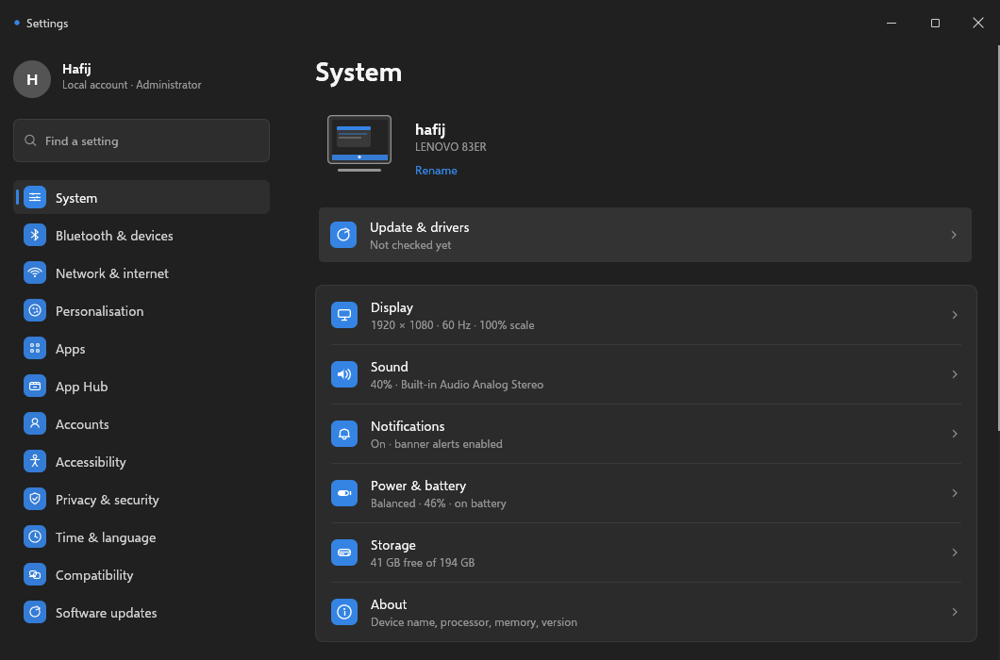

# Settings for Ubuntu (Windows 11 style)

A Windows 11–style Settings application for Ubuntu, written in Rust with
`eframe`/`egui`. It paints its own Fluent-style chrome (title bar, sidebar,
cards, toggles, sliders) and drives the real Ubuntu stack underneath:
`gsettings`/`dconf`, `wpctl`/`pactl`, `nmcli`, `bluetoothctl`, `powerprofilesctl`,
`org.gnome.Mutter.DisplayConfig` (through `python3-gi`), `AccountsService`, `df`, `/proc` and `/sys`. Everything is edited inside this app — it never opens GNOME Settings for you.

Application management is built in: a tab bar (My Apps · Updates · Library ·
All Apps) brings the catalogue to the top of the Apps page, and Ubuntu package
updates are one click away. The inventory, uninstalls, cleaner and disk bar
are standalone (dpkg/snap/flatpak, no App Hub required); only the GitHub
catalogue tabs use App Hub and hide themselves when it is not installed.



Performance notes (0.5.9): the first frame already shows real storage,
hardware and network values, because every probe writes a snapshot to
`~/.cache/win11-settings/info.json` and the next launch paints it while the
live probe runs. The probe itself dropped from ~2.7 s to well under a second
in a debug build: default applications are resolved by reading the same
`mimeapps.list` files `xdg-mime` reads (one process per MIME type cost ~70 ms
each), settings come from two bulk calls (`gsettings list-recursively` +
`dconf dump /`), the home-directory size runs as a separate background job,
Wi-Fi listings do not force a radio scan on every refresh, and the full
installed-app inventory is scanned only when the All Apps tab is opened.


## Features

| Area | What it does |
| --- | --- |
| System | Device card with rename (`hostnamectl` via PolicyKit), update status, display/sound/notifications/power/storage/pointer/keyboard/default-applications/about shortcuts — every control is edited in place, with no hand-off to GNOME Settings |
| Display | Resolution, refresh rate and fractional scale applied through the compositor (`org.gnome.Mutter.DisplayConfig`, works on Wayland), brightness slider (systemd-logind backlight path, no password prompt), night light switch that warms the screen immediately, adjustable strength, and an optional schedule (sunrise/sunset or custom hours) |
| Sound | Volume and mute (PulseAudio or PipeWire), microphone volume and mute, output **and input** device pickers, test sound |
| Notifications | Banners and lock-screen alerts |
| Power & battery | Battery level, power profiles, screen timeout, automatic suspend on AC/battery, lid-close action, power-button action, power saver at low battery, battery percentage in the top bar |
| Storage | Root usage plus mounted volumes with progress bars |
| About | Full specifications and clipboard copy |
| Bluetooth / Network | Adapter switch, discoverable switch, non-blocking background scan, pair/connect/disconnect; Wi-Fi radio switch, Wi-Fi scan and password-based connection, plus manual/automatic proxy (HTTP, HTTPS, SOCKS, ignored hosts) |
| Personalisation | Light, dark and “follow Ubuntu” modes; 8 accent swatches plus any custom colour; wallpaper picker applied to light/dark/lock screens; pointer size; writes the theme and accent back to GNOME |
| Apps | Windows-11–style tab bar — **My Apps**, **Updates** (badged with pending apt + App Hub updates), **Library** and **All Apps**. The first two manage the App Hub catalogue exactly as App Hub 1.7 reports it — real app icons, per-app errors, stale-cache markers, update-all, install/update/open/uninstall; **Library** groups the GitHub projects publishing .deb releases by owner with Install/Update/Open/Remove-from-Library, then lists **Saved installs** (App Hub's Favorites: Deb, Snap, Flatpak and catalogue recipes) with one-click install through PolicyKit; **All Apps** lists every installed apt/snap/flatpak/local app with icon, version, source, size and Open/Uninstall (protected system packages are marked and cannot be removed) |
| Accounts | User, groups, home and shell; change the account name (AccountsService), change the password (PolicyKit), automatic sign-in toggle |
| Accessibility | Text size (also writes GNOME’s scale), large text, visual alerts, animations, sticky keys, mouse keys — every switch writes `gsettings` and takes effect immediately |
| Mouse & touchpad | Pointer speed, pointer size, natural scrolling, left-handed, tap to click, two-finger scrolling, disable while typing |
| Keyboard | Input sources with a searchable XKB layout catalogue (add/remove), key repeat switch, delay and repeat rate |
| Default applications | Browser, mail, text editor, documents (Word/OpenDocument), spreadsheets (Excel/CSV), presentations (PowerPoint), PDF, photos, video, music, archives and calendars — all via the real freedesktop handlers (`xdg-settings` / `xdg-mime`), using MIME declarations from system, snap and flatpak desktop files |
| Privacy & security | Screen lock, lock-screen notifications, location, camera, microphone, file history, temp cleanup, problem reporting — all live |
| Time & language | Timezone (browsable searchable list applied via `pkexec timedatectl`, with success feedback), automatic internet time, language picker (`localectl` + `locale-gen`), live local clock, 24-hour clock, top-bar date/weekday/seconds |
| Compatibility | Wine, Waydroid and Steam detection with one-click “Install” through PolicyKit apt when missing |
| Software updates | `apt` check with versions, install all updates in one PolicyKit prompt (including Ubuntu’s phased rollouts), refresh package lists, automatic security updates switch (unattended-upgrades), restart-required banner |
| Search | Live filtering across every page with <kbd>Ctrl</kbd>+<kbd>F</kbd> |

## Build and run

```sh
cargo build --release
./target/release/win11-settings
```

Dependencies are ordinary desktop tools that ship with Ubuntu. Missing helpers
degrade gracefully (for example, `wpctl` is used when `pactl` is absent and
brightness reports “unavailable” without a backlight).

## Install

```sh
sudo install -Dm755 target/release/win11-settings /usr/local/bin/win11-settings
sudo install -Dm644 win11-settings.desktop /usr/local/share/applications/win11-settings.desktop
sudo install -Dm644 assets/win11-settings.svg \
  /usr/local/share/icons/hicolor/scalable/apps/win11-settings.svg
```

Then launch **Settings** from the app grid, or run `win11-settings`.

### Debian package

Build a local `.deb` (the package installs under `/usr/local`, so it does not
replace Ubuntu's built-in Settings application):

```sh
./packaging/build-deb.sh
sudo apt install ./dist/win11-settings_0.5.11_amd64.deb
```

Remove it with `sudo apt remove win11-settings`.

## Application catalogue (optional, App Hub)

The **My Apps** tab shows only the base catalogue (your own projects) plus
anything you added with `app-hub add --mine` — third-party Library apps from
other sources never appear there, and “Available to install” lists Markd, the
only catalogue app that is not installed. **Updates** (application updates) and **Library** talk to
the same `app-hub` command used by Application Hub, so there is one source of
truth for the catalogue, downloads and the PolicyKit helper:

- `app-hub list` is parsed for versions and statuses,
- `app-hub install/update/remove/open` are run for individual actions,
- `app-hub update-all --apps-only --yes` updates every App Hub application,
- `/usr/lib/app-hub/catalog.json` supplies names and summaries.

The **Library** tab shows every GitHub project that publishes .deb releases,
grouped by owner (the shipped defaults plus the projects you added with
`app-hub add`). Paste a link, an `owner/repo`, or a whole account into the
“Add an application” box; each row installs, updates or opens the app through
the same job system as My Apps. “Remove” only drops the Library entry — it
never uninstalls the application.

Without App Hub, the catalogue tabs hide themselves; **All Apps**, the Ubuntu
side of **Updates**, the cleaner and everything else keep working.
Ubuntu package updates are handled separately by the Software updates page
(`apt-get update` / `apt-get upgrade` through `pkexec`), so app and system
updates stay clearly separated.

The **All installed applications** inventory is standalone (no App Hub): it
scans the package managers’ own caches — `dpkg`/`apt` (with `dpkg-query -S`
mapping launchers to packages), `snap list` and `flatpak list` (system and
user installations) — in one Python pass. Real icons, `version · source ·
size` subtitles (e.g. `Ubuntu resolute/main`, `flathub · system`, `Local
.deb`), channel chips, Open (via the launcher) and Uninstall. Removing an
apt package first simulates the removal (`apt-get -s remove`) and lists what
else would disappear, warning when it includes parts of the desktop;
system-critical packages (apt, dpkg, systemd, gnome-shell, snapd, flatpak,
…) are never offered for uninstall. Uninstalls run through one `pkexec`
prompt (apt via `apt-get remove`, snap via `snap remove`, flatpak via
`flatpak uninstall`); user flatpaks need no password. Desktop-only “local”
apps (launchers in `~/.local/share/applications` not owned by a package)
move to the Trash along with their program file — but only when the program
file lives inside your home directory; system files are never touched.

The **Activity Log** (button on the Apps hero and on the Software updates
page) shows a live spinner and the streamed command output of the running
job — installs, updates and uninstalls — followed by a reverse-chronological
history of everything the app did, with errors in red. `Clear log` wipes the
history. Job output is piped line-by-line instead of being buffered until
the command exits.

**Free Up Space** — the System page shows a slim disk bar under the profile
("Ubuntu: X GB free of Y GB", a used-space meter that turns amber/red when
the disk fills up) with a **Free Up Space** button, like App Hub's bottom
bar. It opens a standalone cleaner (no App Hub required): downloaded package
files (`apt clean`), unused dependencies (`apt autoremove`), leftover `/etc`
configs from removed packages (purged), old snap revisions, unused Flatpak
runtimes, and app data left behind in `~/.var/app` and `~/snap` by removed
applications. Every group is shown with sizes and toggles; files go to the
Trash (recoverable) and privileged work runs through one `pkexec` prompt;
progress streams into the Activity Log.

**Restart** after an update goes through logind (`systemctl reboot`), which an
active desktop session may do without a password prompt; if that is refused it
falls back to `pkexec systemctl reboot` and then
`pkexec shutdown -r +1`, reporting the real error if all attempts fail.

## Useful environment variables

| Variable | Purpose |
| --- | --- |
| `WIN11_SETTINGS_MODE=dark\|light` | Force a mode instead of following Ubuntu |
| `WIN11_SETTINGS_VIEW=<page>` | Open a page at start (e.g. `apps`, `display`, `privacy`) |
| `WIN11_SETTINGS_APPS_TAB=myapps\|updates\|library\|allapps` | Open a specific Apps-page tab |
| `WIN11_SETTINGS_SCREENSHOT=/path.png` | Render one frame, save a PNG and exit |
| `WIN11_SETTINGS_PROBE=1` | Time one system probe without opening a window |
| `WIN11_SETTINGS_STARTUP=1` | Report whether the startup snapshot was used and when the first frame appeared |
| `WIN11_SETTINGS_NOCACHE=1` | Ignore the startup snapshot (cold-start testing) |
| `WIN11_SETTINGS_MIME=1` | Print how every default-application type resolves |
| `WIN11_SETTINGS_FAVORITES=1` | Print the install recipes saved in App Hub's Favorites |

## Fonts

Selawik (a Segoe UI metric-compatible design by Microsoft) is bundled under
`assets/fonts/` with its SIL Open Font License. All icons are vector-painted at
runtime; there is no icon font.
